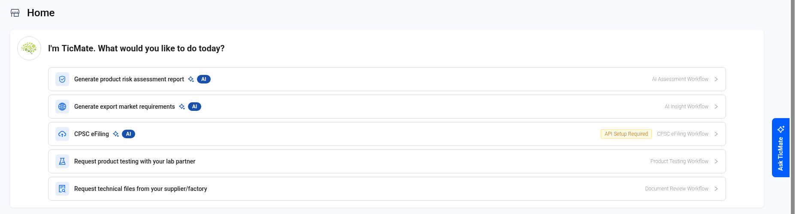
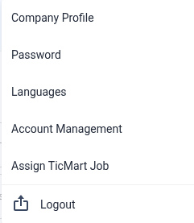
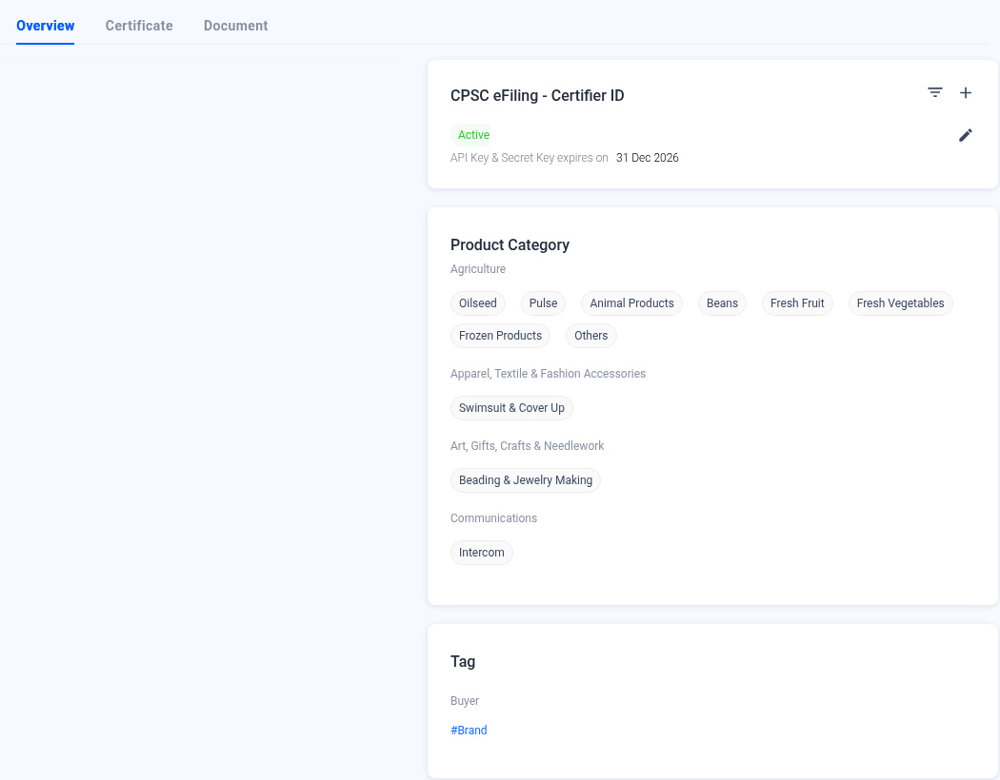

# Getting Started — Home, Settings and Company Profile

> Working copy draft 2026-11-09-draft. English text from the published QMAS User Guide. Unreviewed screenshots are omitted.

Find your way around QMAS: the Home page, the top bar and your company settings.

- **Home:** https://qmas.icw.io/home
- **Company Profile:** https://qmas.icw.io/company-profile
- **Checked against:** QMAS dev, 9 Nov 2026

## Overview

1. **Home** shows quick workflows, items that need your attention, and an overview of your business.
2. The **left menu** opens each module.
3. The **top bar** has analytics, messages, notifications, the account avatar, help and credits.
4. **Settings** opens from the **avatar** (account control) in the top bar. The menu includes Company Profile, Password, Languages, Account Management, Assign TicMart Job and Logout.

## Step-by-step

### 1. Home

**TicMate** says “I’m TicMate. What would you like to do today?” and lists these workflow shortcuts:

- **Generate product risk assessment report** (AI Assessment workflow).
- **Generate export market requirements** (AI Insight workflow).
- **CPSC eFiling**. If it shows “API Setup Required”, set up your Certifier ID in Company Profile first.
- **Request product testing with your lab partner** (Product Testing).
- **Request technical files from your supplier/factory** (Document Review).

**Attention** counts the items that need action in each module, such as Product Testing, Document Review, QC Inspection, IQC Inspection, Factory Audit, Pending Review Doc and Expired Doc. Click a card to see them.

**Business Overview** shows your active products, suppliers, factories and partners. Click **›** to open the list.

**Ask TicMate** on the right edge opens the TicMate assistant.

*Home page.*

This reviewed screenshot shows the TicMate workflow shortcuts. Attention and Business Overview are described in the steps and are not in this crop.

### 2. Settings menu

Click your **avatar** (account control) in the top bar:

| Option | What it does |
|---|---|
| Company Profile | Company details, certificates, documents, product categories and CPSC eFiling Certifier ID. |
| Password | Change your password. |
| Languages | Change the system language. |
| Account Management | Manage your company's user accounts. |
| Assign TicMart Job | Assign jobs from the TicMart marketplace. |
| Logout | Signs you out of QMAS. |

*Settings menu.*

Menu opened from the account avatar: Company Profile, Password, Languages, Account Management, Assign TicMart Job and Logout.

### 3. Company Profile

Click the pencil icon next to the company name to edit it. The **Overview**, **Certificate** and **Document** tabs hold your company information. **CPSC eFiling - Certifier ID** is where you add and manage the API key for eFiling. **Product Category** lists the categories your company works with.

*Company Profile.*

## Tips

- The question-mark icon opens the QMAS Help Center.
- The coin icon shows your credits and tokens for paid features such as AI Insight.

## FAQ

**Q: How do I change the language?**

A: Click your avatar (account control) in the top bar, then Languages.

**Q: How do I change my password?**

A: Click your avatar (account control) in the top bar, then Password.

**Q: Where do I edit my company information?**

A: Click your avatar (account control), then Company Profile (https://qmas.icw.io/company-profile).
