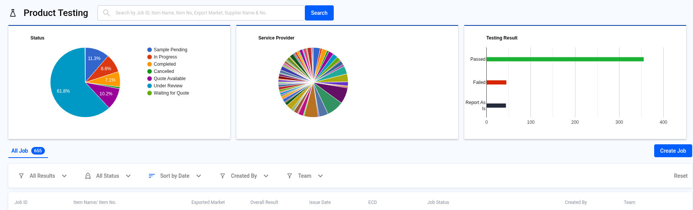
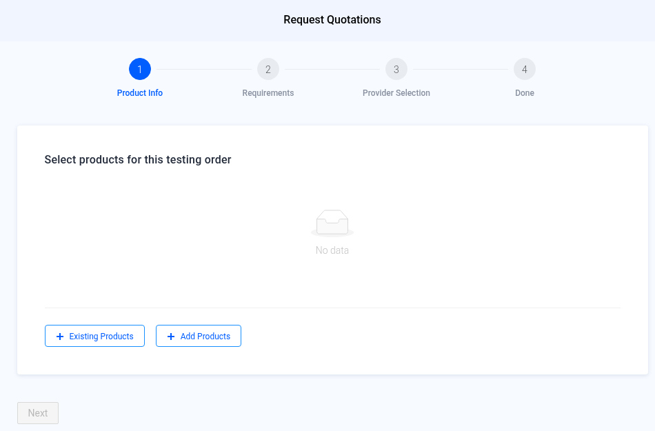
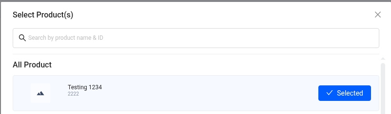
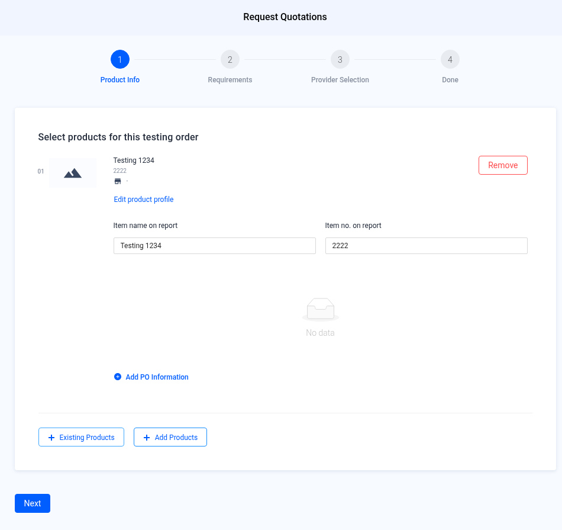
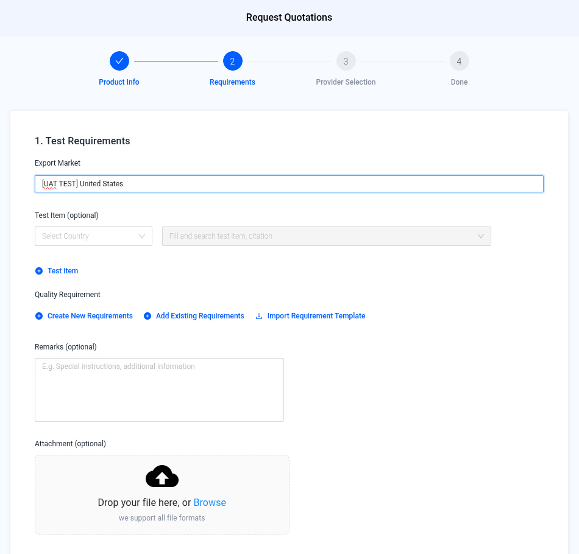
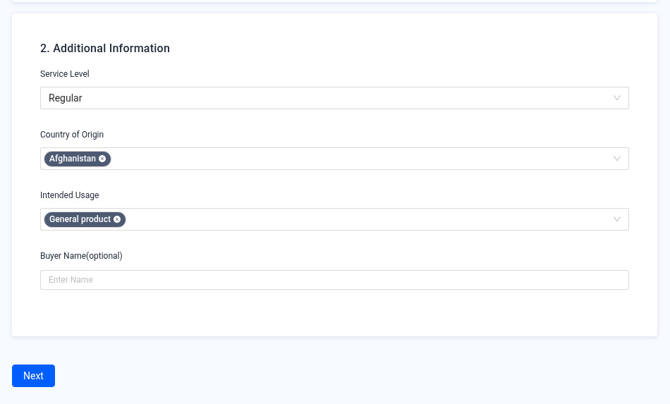
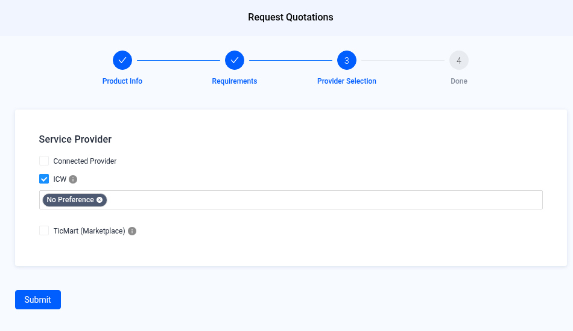
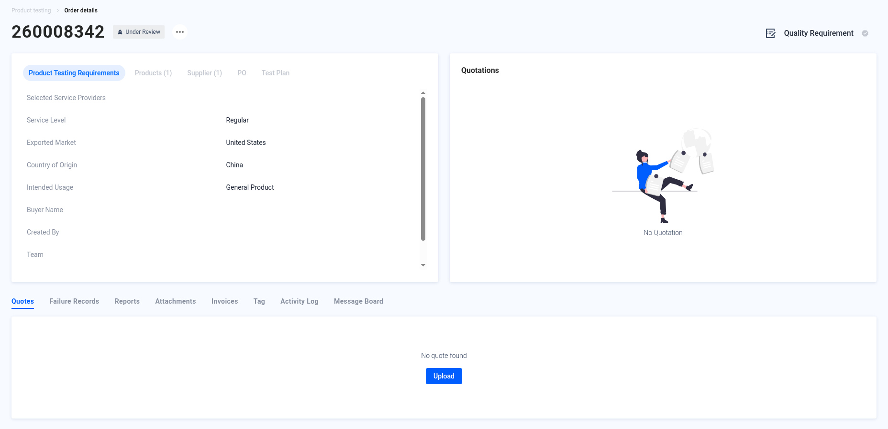
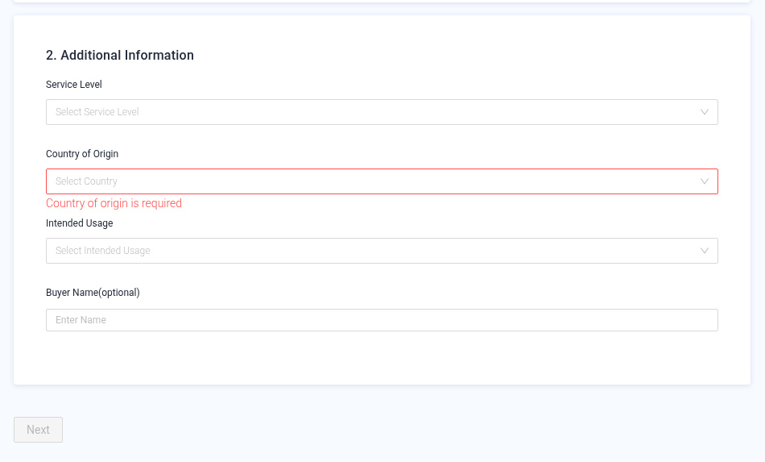

# Product Testing — Request a Quotation

> Working copy draft 2026-11-09-draft. English text from the published QMAS User Guide. Unreviewed screenshots are omitted.

Create a product testing job and get a quotation from a laboratory.

- **Module:** Product Testing
- **Start here:** [qmas.icw.io/product-testing](https://qmas.icw.io/product-testing) → **Create Job**
- **Direct link:** [qmas.icw.io/product-testing/create-job](https://qmas.icw.io/product-testing/create-job)
- **Steps:** 1 Product Info → 2 Requirements → 3 Provider Selection → 4 Done

## Overview

1. **Open Product Testing** and click **Create Job**.
2. **Product Info** — add an existing product or create a new one.
3. **Requirements** — set the export market, test items, quality requirements and service details.
4. **Provider Selection** — choose Connected Provider, ICW or TicMart, then **Submit**.
5. **Done** — the Order details page opens. Track the job there or in the Product Testing list.

## Step-by-step

### 1. Open Product Testing

In the left menu, open **Product Testing**. The page shows charts of job status, service provider and test results, and the list of all jobs. Click **Create Job** above the list.

*Product Testing list — Create Job is at the top right of the job list.*

### 2. Product Info — select products

The **Request Quotations** wizard opens. Add the products for this testing order:

- **+ Existing Products** picks from your Product Management list.
- **+ Add Products** creates a new product here.

*Step 1 starts empty. Next stays disabled until a product is added.*

In the **Select Product(s)** pop-up, search by product name or ID, click **Select** on each product you need, then click **Confirm**. You can select more than one product.

*A selected product shows a blue “✓ Selected” button.*

Check the product details. You can change **Item name on report** and **Item no. on report**, which are printed on the test report. Click **Add PO Information** to link a purchase order (optional). Then click **Next**.

*Use Remove to drop a product, or Edit product profile to update it.*

### 3. Requirements

**1. Test Requirements**

- **Export Market** — where the product will be sold (required).
- **Test Item** (optional) — choose a country, then search for test items or citations.
- **Quality Requirement** — Create New Requirements, Add Existing Requirements, or Import Requirement Template.
- **Remarks** and **Attachment** (optional) — special instructions and reference files.

*Export Market filled in.*

**2. Additional Information**

- **Service Level** — Regular, Express or Shuttle / Emergency.
- **Country of Origin** — where the product is made (you can pick more than one).
- **Intended Usage** — General product, Adult product, Children product or Toys.
- **Buyer Name** (optional).

When all required fields are filled, **Next** turns blue. Click it.

*Additional Information filled — Next is now enabled.*

### 4. Provider Selection

Choose who should quote this job. You can tick more than one:

| Option | Use it when |
|---|---|
| Connected Provider | You already work with a lab that is connected to your QMAS account. |
| ICW | You want ICW to find a lab. Pick a preferred lab, or leave “No Preference”. |
| TicMart (Marketplace) | You want quotations from labs in the TicMart marketplace. |

*ICW ticked with “No Preference”. Click Submit to send the request.*

### 5. Done — track your order

After you click **Submit**, QMAS shows “Product testing created successfully” and opens the **Order details** page. Your job has a new order number (for example 260008342) and starts as **Under Review**.

- **Product Testing Requirements**, **Products**, **Supplier**, **PO** and **Test Plan** tabs show what you submitted.
- **Quotations** on the right shows lab quotes when they arrive.
- The tabs below (Quotes, Failure Records, Reports, Attachments, Invoices, Tag, Activity Log, Message Board) follow the job until the report is ready.

*The new order opens with status Under Review. You can find it again in the Product Testing list.*

## Tips

- Items marked **(optional)** can be skipped. Next stays grey until every required field on the step is filled. A field you leave empty turns red with a message, for example “Country of origin is required”.

*Required field left empty.*
- Item name and item no. on report are what the lab prints on the test report. Check them before you continue.
- To leave the wizard, click **✕** at the top right.
