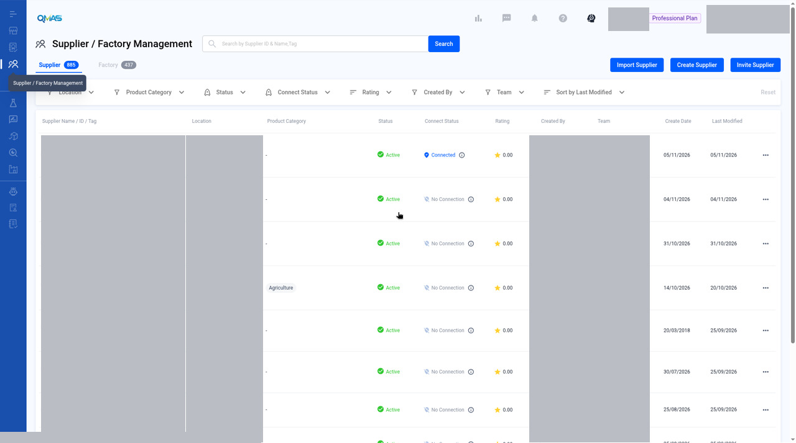
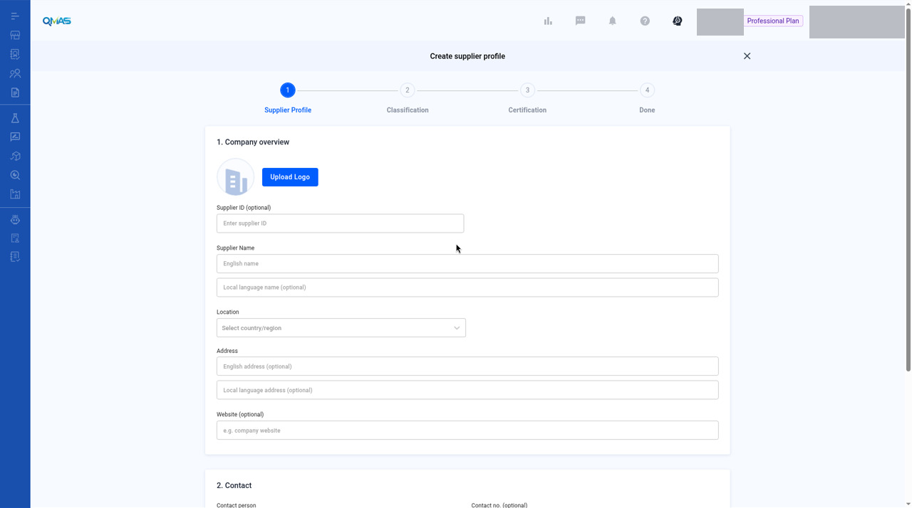
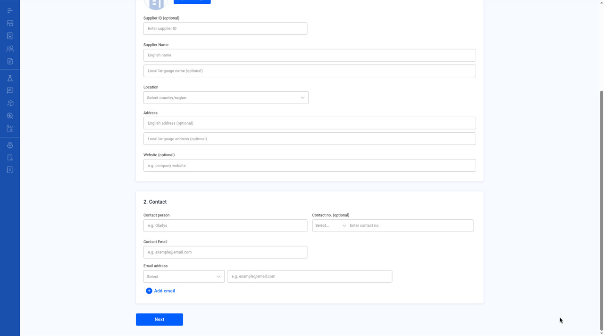
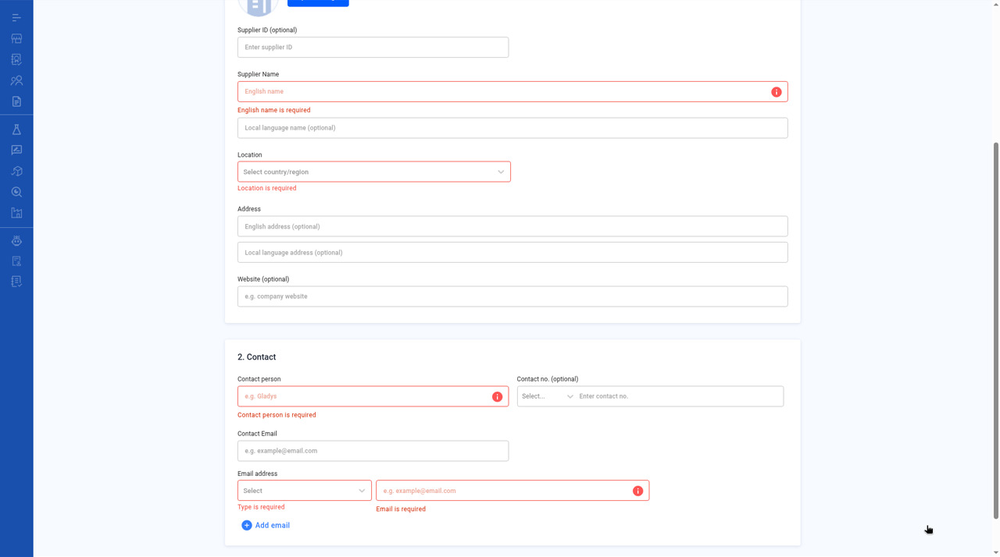

# Supplier Management — Create a Supplier

> Working copy draft 2026-11-13-draft. English text from the published QMAS User Guide. Unreviewed screenshots are omitted.

Add a supplier profile so you can link it to products, factories, documents and service jobs.

- **Module:** Supplier / Factory Management
- **Start here:** https://qmas.icw.io/supplier-manager/suppliers → **Create Supplier**
- **Direct link:** https://qmas.icw.io/supplier-manager/create
- **Steps:** 1 Supplier Profile → 2 Classification → 3 Certification → Done
- **Checked against:** QMAS dev, 4 Nov 2026

## Overview

1. Open **Supplier / Factory Management**, stay on the **Supplier** tab and click **Create Supplier**.
2. **Supplier Profile**: company overview and contact.
3. **Classification** (optional): product category and tags.
4. **Certification** (optional): add certificates, then click **Done**.
5. The supplier profile opens.

## Step-by-step

### 1. Open Supplier / Factory Management

In the left menu, open **Supplier / Factory Management**. The **Supplier** tab lists your suppliers with their location, category, status, connect status and rating.

Click **Create Supplier**. You can also use **Import Supplier** to add many suppliers from a file, or **Invite Supplier** to invite a supplier to connect with you on QMAS.

*Supplier tab with Import Supplier, Create Supplier and Invite Supplier.*

### 2. Supplier Profile — company overview

- **Upload Logo** (optional).
- **Supplier ID** (optional): your own reference number.
- **Supplier Name**: English name (required) and local-language name (optional).
- **Location**: country or region, then province and city.
- **Address** and **Website** (optional).

*Create supplier profile — step 1, Company overview.*

### 3. Supplier Profile — contact

Under **2. Contact**, fill in the **Contact person**, **Contact Email** and at least one **Email address**. For each email address, choose a type: Company, QA, Sales or Other. Click **Add email** for more. **Contact no.** is optional.

*Contact section.*

If a required field is empty when you click **Next**, it turns red, for example “Type is required” or “Email is required”. This screenshot also shows **English name is required**, **Location is required**, and **Contact person is required**. Next triggers the errors, not Submit. The fields still show empty or example placeholders, not a completed profile.

*The email type and email address are required.*

Also shows required errors on English name, Location, and Contact person. Triggered by Next, not Submit. Blank or example placeholders only.

### 4. Classification (optional)

Click **Select category** to choose the product categories this supplier offers. Click **Select tag** to add your own tags. Click **Next**.

> **Image pending privacy review:** `05-step2-classification.jpg`
>
> Reviewed replacement image not available yet. Follow the written steps above.

*Step 2 Classification.*

### 5. Certification (optional)

Click **Add** to upload a certificate. Choose the certification type, upload the file, and fill in the rating, issue party and dates. Click **Done** to create the supplier.

> **Image pending privacy review:** `06-step3-certification.jpg`
>
> Reviewed replacement image not available yet. Follow the written steps above.

*Step 3 Certification.*

### 6. Done — supplier profile

The supplier profile opens. Use the tabs **Overview**, **Product**, **Factory**, **Certificate**, **Document** and **Compliance Data** to manage everything linked to this supplier. Click the pencil icon next to the name, or next to **Contact**, to edit.

> **Image pending privacy review:** `07-supplier-profile.jpg`
>
> Reviewed replacement image not available yet. Follow the written steps above.

*Supplier profile — Overview tab.*

## Tips

- Search the Supplier list before you create a supplier so you don’t add a duplicate.
- Consistent tags make filtering the list easier later.

## FAQ

**Q: How do I create a new supplier?**

A: Go to Supplier / Factory Management (https://qmas.icw.io/supplier-manager/suppliers), click Create Supplier, fill in Supplier Profile, then Next, Next and Done. Direct link: https://qmas.icw.io/supplier-manager/create

**Q: Can I add many suppliers at once?**

A: Yes. Click Import Supplier on the Supplier tab.

**Q: How do I invite a supplier to QMAS?**

A: Click Invite Supplier on the Supplier tab.

**Q: How do I edit a supplier?**

A: Open the supplier from the list and click the pencil icon next to its name or next to Contact.

## Help Center additions and remaining gaps

This section adds Help Center material and named gaps. It does not replace the steps above.

- **Source-documented** — written in the original Help Center. The last-edited date is given. That does not by itself prove the current QMAS UI.
- **Dev-verified** — confirmed on qmas-dev.icw.io during guide work.
- **Gap** — named as missing or too thin. Not current behaviour until checked on dev.

Reviewed screenshots remain 54 of 98. Forty-four inventory slots are still pending. Four supplementary images (one Factory validation and three QC views) are not part of the 98. Unreviewed screenshots were not copied.

### Source-documented — profile, import, and invite (last edited 2026-01-16)

Source: Manage your QMAS Supplier Compliance Profile, https://app.notion.com/p/aa532b63c9554db99b57676ee83d489c. It was not marked “Updated November 2026”. Labels need a dev check before they are published as current UI.

The 2024 setup guide is an older subset (no Import or Invite) and still says “top menu bar”. Prefer the create steps above, and the January 2026 article for the items below.

**Edit and add documents** (Help Center): edit company and contact information with the icon next to each section. Edit categories and tags with the pen icon. **Add rating** lists Responsiveness, Quality, Pricing, and Market Awareness. Add **Internal notes** for others in the company. Add missed certificates or documents later in the **CERTIFICATE** and **DOCUMENT** sections.

**Product and Factory linkage** (Help Center): related products use **+Product Linkage** (existing product list, or **New Product**). Related factories are under **FACTORY**, then **+Factory Linkage** (**Current Factory** or **New Factory**).

**Import Supplier** (Help Center): click **Import Supplier**, then **Download here** for the template, fill it in (the article says create, update, and delete are supported), upload, and click **Next**. A toast confirms completion.

Invite / connect a supplier “allows you to assign Document Review jobs to your connected suppliers.”

1. Click **Invite Supplier**.
2. Choose a supplier from the existing list, or invite a new supplier by entering their name.
3. Optionally enter a custom message for the invitation email.
4. Click **Invite**. The Help Center says an invitation email is sent to the supplier’s email address.
5. The supplier can accept via the invite link or, if they already have a QMAS account, via a pop-up the next time they log in.

Help Center connection statuses: **Invite** (invitation sent), **No Connection** (cannot interact via the platform), **Connected** (can be assigned Document Review jobs).

### Remaining gaps

- Current-UI confirmation of the labels above, especially linkage buttons and connection statuses.
- Screenshots for import, invite, ratings, notes, and tabs other than Overview.
- List filters, Export, and the row toolbar.
- Contact Email versus Email address, and Title Case. Filed bugs; re-check on dev. Do not invent the corrected labels.

Help Center reconciliation 2026-11-13 (HKT). Original Help Center not edited. This draft is not the public guide. No Dify upload.
